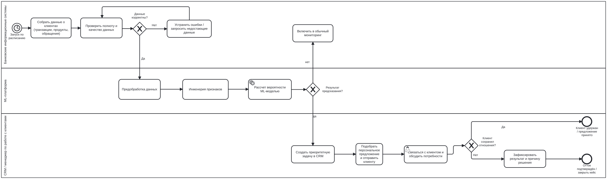

Бизнес-процесс предназначен для выявления клиентов банка с высоким риском оттока и организации своевременных мероприятий по их удержанию. Процесс запускается по расписанию, например ежемесячно или при выполнении определенного действия. На основе информации о клиентах ML-модель оценивает вероятность ухода каждого клиента, после чего результаты прогнозирования используются для формирования приоритетных задач в CRM и подготовки персональных предложений.
Что делает алгоритм ML в бизнес-процессе
Алгоритм машинного обучения выполняет функцию интеллектуальной оценки риска оттока клиентов. Его работа включает несколько этапов:
1. Получение данных. Используются сведения о транзакциях, банковских продуктах и обращениях клиентов.
2. Подготовка данных. Проверяется полнота и качество информации, устраняются ошибки и выполняется предобработка.
3. Инженерия признаков. На основе исходных данных формируются дополнительные характеристики клиентов, которые помогают модели выявлять закономерности поведения.
4. Прогнозирование. ML-модель рассчитывает вероятность ухода каждого клиента.
5. Классификация риска. По результатам прогноза определяется, какие клиенты требуют повышенного внимания.
Как результат ML влияет на бизнес-процесс
- Высокий риск оттока: в CRM создаётся приоритетная задача, менеджер связывается с клиентом, выясняет его потребности и обсуждает возможные варианты удержания.
- Низкий риск оттока: клиент остаётся в обычном режиме мониторинга.
После взаимодействия менеджер фиксирует результат и причину принятого решения. Если клиент сохранил отношения с банком, кейс закрывается как успешный; если отток подтверждён, кейс также закрывается с соответствующим результатом.
Главная бизнес-ценность алгоритма
ML-модель позволяет перейти от реактивной работы с уже ушедшими клиентами к проактивному управлению оттоком. Вместо того чтобы одинаково работать со всей клиентской базой, банк может заранее выявлять клиентов с повышенным риском ухода, расставлять приоритеты и направлять ресурсы менеджеров на наиболее значимые случаи.