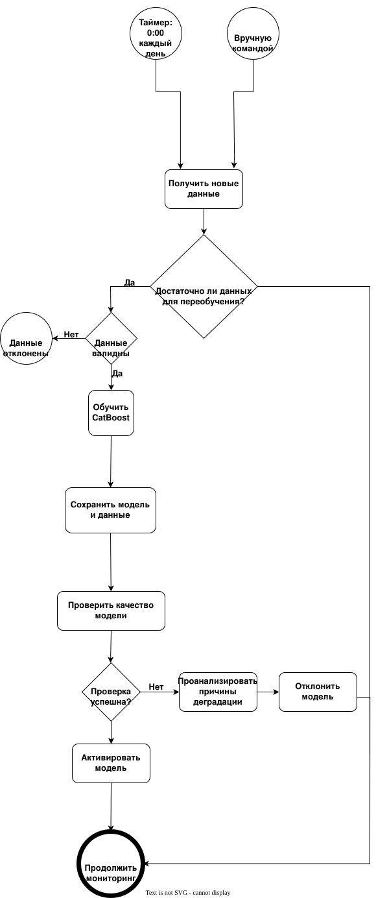

# Процесс автоматического переобучения  Bank Churn Prediction

## 1. Назначение и статус
Этот документ описывает проектируемый нами процесс обучения модели Bank Churn Prediction
 ### Статус проекта:
На данный момент реализовано:

- Загрузка датасета
- Обучение модели (CatBoost)
- Проверка качества
- Сохранение результатов
 
Автоматический запуск по триггеру пока не реализован

## 2. Схема процесса

## 3. Переобучение

-  Триггер должен активироваться каждый день по таймеру или вручную по команде
-  Проверяется объём данных
- Если данных достаточно, система переходит к обучению
- Данные и модель сохраняются
- Проверка качества модели, вычисляется метрика эффективности по ROC-AUC ( > 0.9)
- При успешной проверке на качество модель применяется, в противном случае происходит анализ причины деградации модели и модель отклоняется
- В не зависимости от того, была модель активирована или отклонена, пайплайн завершается до следующего запуска по таймеру и команде
#
- [Model Card](model_card.md)
- [Место модели в процессе](Model_BPMN.md)
